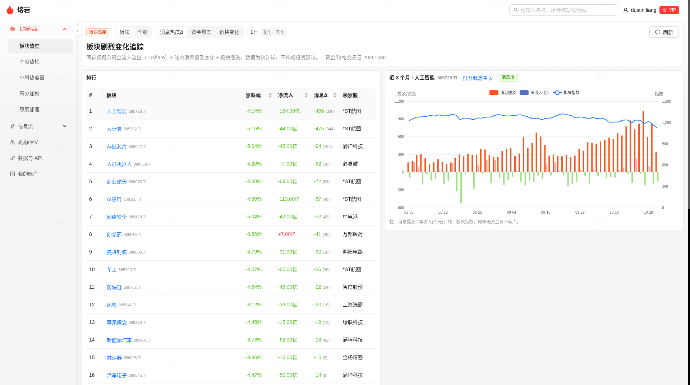
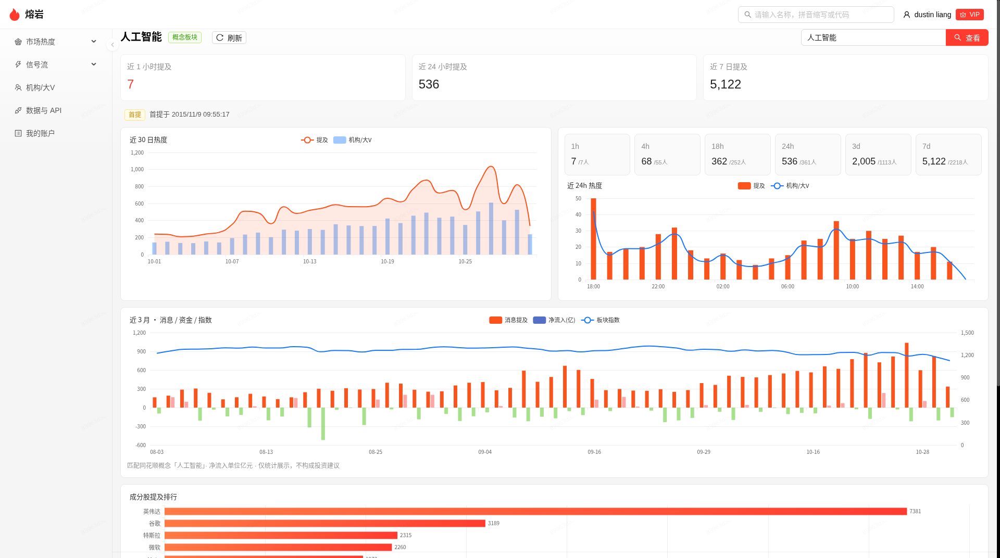
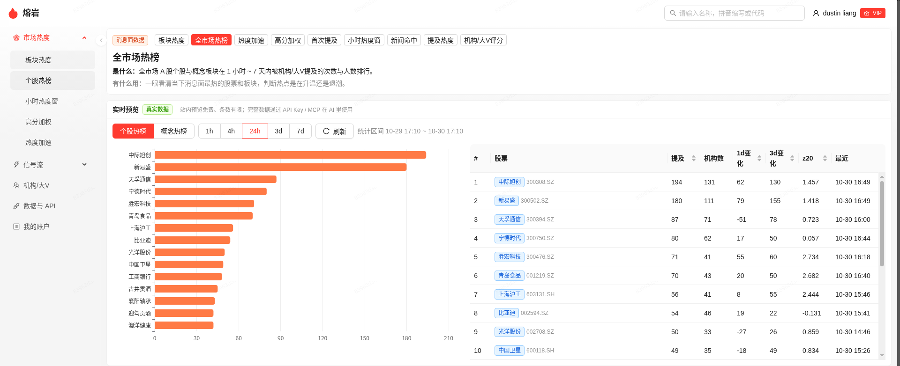
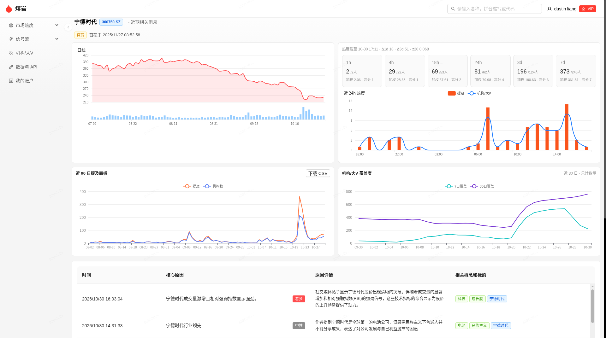
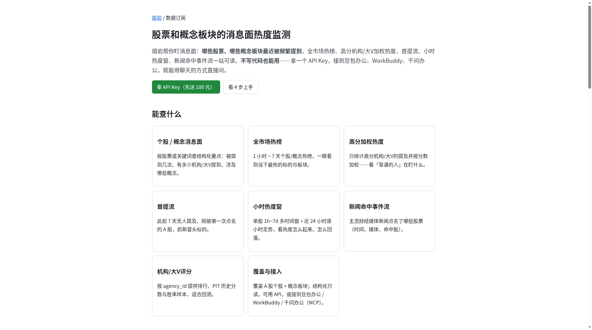

# lava-mcp · 熔岩消息面热度监测

[](https://hookmcp.com)

[熔岩（Lava）](https://lava.ai-dolphin.com/subscribe) 提供 **A 股股票和概念板块的消息面热度监测** 结构化只读数据——支持 **量化交易工具** 与 **AI Agent 股市研究** 接入，通过远程 MCP / REST 调用。

> 只读 · 结构化要点 + 机构/大V ID（`agency_id`）· 新闻命中不含标题与正文

## 新手 3 步

① 开通并复制 API Key（登录熔岩 → 左侧「AI数据服务」→ API Key → 新建；首次登录通常已自动生成「默认」Key）

② 装 Skill，或在豆包办公 / WorkBuddy / 千问办公填 MCP 地址 https://lava.ai-dolphin.com/subscribe/v1/mcp

③ 用中文问「某某股票最近消息面热不热」，或「最近 24 小时全市场哪些股票消息面最热」

## 远程 MCP（推荐）

| 项 | 值 |
| --- | --- |
| 传输 | Streamable HTTP |
| Endpoint | `https://lava.ai-dolphin.com/subscribe/v1/mcp` |
| 鉴权 | 请求头 `Authorization: Bearer <API Key>`（或 `X-API-Key`）；亦支持 OAuth 2.1（PKCE S256 + DCR） |
| 客户端 | 豆包办公、WorkBuddy（BUDDY）、千问办公（QwenWork）等支持自定义 HTTP MCP 的客户端 |

开通与计费见 [落地页](https://lava.ai-dolphin.com/subscribe)：开通赠 100 元代金券；约 1000 次 = 5 元。

## 本地 Streamable HTTP 代理

[`proxy/server.py`](./proxy/server.py) 是可运行的薄代理（Python 3.9+，仅标准库）。它不实现熔岩的查询接口，只把 MCP 的 Streamable HTTP / JSON-RPC 原样转到官方端点，并附上 `Authorization: Bearer <LAVA_API_KEY>`。个股、概念和热榜数据仍来自 `https://lava.ai-dolphin.com`。

直接连接官方端点仍然是推荐方式。本地代理适合需要在本机审计转发代码，或客户端不方便单独配置远程请求头的时候。

```bash
export LAVA_API_KEY=lvk_你的Key
python3 proxy/server.py
```

默认监听 `http://127.0.0.1:8787/mcp`（只绑定本机）。

| 环境变量 | 说明 |
| --- | --- |
| `LAVA_API_KEY` | 熔岩 API Key。设置后，每个转发请求都带 `Authorization: Bearer <key>` |
| `LAVA_PROXY_PORT` | 监听端口，默认 `8787` |
| `LAVA_PROXY_HOST` | 监听地址，默认 `127.0.0.1`。监听非本机地址时还要设置 `LAVA_PROXY_ALLOW_REMOTE=1` |
| `LAVA_MCP_UPSTREAM` | 上游地址，默认 `https://lava.ai-dolphin.com/subscribe/v1/mcp` |
| `LAVA_PROXY_TIMEOUT` | 上游超时（秒），默认 `180`；`0` 表示不限制 |

客户端把 MCP 地址填成 `http://127.0.0.1:8787/mcp`，传输选 Streamable HTTP。Key 放在启动代理的环境里即可。未设置 `LAVA_API_KEY` 时，才会原样转发客户端自己的 `Authorization` 头。

```bash
curl -sS http://127.0.0.1:8787/health

curl -sS http://127.0.0.1:8787/mcp \
  -H 'Content-Type: application/json' \
  -H 'Accept: application/json, text/event-stream' \
  -d '{"jsonrpc":"2.0","id":1,"method":"initialize","params":{"protocolVersion":"2025-06-18","capabilities":{},"clientInfo":{"name":"curl","version":"0"}}}'
```

`GET /health` 只检查代理进程，不访问上游。本地测试：`python3 -m unittest proxy.test_server`。

## Skill 模板

仓库内 [`SKILL.md`](./SKILL.md) 与线上官方模板对齐（含全市场热榜、加权、首提、多时间窗、加速榜、日频面板、机构覆盖度与新闻点名）。官方模板：

https://lava.ai-dolphin.com/subscribe/v1/skill

## 文档与机器可读规范

- 产品落地页：https://lava.ai-dolphin.com/subscribe
- API 文档（canonical）：https://lava.ai-dolphin.com/subscribe/docs
- OpenAPI 3.0：https://lava.ai-dolphin.com/subscribe/v1/openapi.json
- llms.txt：https://lava.ai-dolphin.com/llms.txt
- MCP Registry：[`server.json`](./server.json)
- 本地代理：[`proxy/server.py`](./proxy/server.py)
- Glama：[`glama.json`](./glama.json) · 线上 `/.well-known/glama.json`

## 数据模块一览

熔岩同时有站内看板和订阅 API / MCP。数据是 **A 股机构/大V 舆情的结构化只读**：概念和标的给摘要要点，机构/大V 用匿名 `agency_id`。订阅落地页是 https://lava.ai-dolphin.com/subscribe ；文档、OpenAPI、MCP 与 Skill 都在同一域名下。

表中的工具名与本文以及线上 OpenAPI 一致。板块趋势和情绪面的订阅路径尚未开放。

| 模块 | 站内 | 订阅 API / MCP | 说明 |
| --- | --- | --- | --- |
| 个股消息面热度 | 个股页 / 市场热度 | `get_stock_news_heat`、`get_stock_heat_windows`、`search_news_flow` | 提及次数、机构/大V 覆盖、摘要要点 |
| 概念板块消息面热度 | 概念页 / 概念热榜 | `get_market_hot_concepts`、`get_concept_stock_heat`、`get_stock_concept_heat` | 概念提及排行，以及概念与个股互查 |
| 全市场热榜 / 加速 / 首提 / 高分加权 | 市场热度 | `get_market_hot_stocks`、`get_accelerating_hot_stocks`、`get_first_mention_stocks`、`get_weighted_hot_stocks` | 多时间窗；动量字段为纯统计量 |
| 日频热度面板 / 机构覆盖度 | 个股页 | `get_stock_heat_panel`、`get_agency_coverage` | 日频序列与覆盖计数，适合回测与导出 |
| 新闻点名 | — | `get_news_stock_hits` | 只返回 `news_id`、媒体、命中股票；无标题、无正文 |
| 机构/大V 评分（PIT） | 市场热度 | `get_agency_ranking`、`get_agency_pit`、`get_agency_history`、`list_agency_pit_dates` | 用 `agency_id`；分数大约 450~1500 |
| 板块趋势 | 站内已上线：侧栏「市场热度」→「板块热度」 | 站内可用 · 订阅接口规划中 | 消息热度 Δ、资金流入流出、价格指数与成分股；口径对齐东财/同花顺 |
| 情绪面（聚合） | 规划中 · 求准优先 | 规划中 | 对外只准备聚合统计；趋势线与订阅接口质量达标后再开放 |

### 板块趋势（站内已上线 · 订阅接口规划中）

左侧「市场热度」可以切到「板块热度」。默认页是剧烈变化追踪，同时看消息热度变化、资金流入流出和价格变化。点进板块后，详情给出近三个月的消息面、资金流、价格指数（有数据才画）和成分股提及。板块命名对齐东财/同花顺口径。

站内已上线。订阅接口规划中，目前以站内页面为准。



侧栏「市场热度 → 板块热度」：按消息热度变化、资金净流入和价格变化看板块；右侧是选中板块近三个月的消息提及、净流入和板块指数。



板块详情：近 1 小时 / 24 小时 / 7 日提及，近 30 日与近 24 小时的提及和机构/大V，近三个月消息、资金与指数，以及成分股提及排行。

### 个股 / 概念热度（站内 + MCP）

全市场热榜、热度加速、高分加权、首提、小时窗、日频面板和机构覆盖度都已经能通过上表里的 MCP / REST 工具读取。站内「市场热度」是同一套统计的预览。



全市场热榜的个股视图：1 小时到 7 天窗口内，按机构/大V 提及次数和人数排序，并给出 1 日变化、3 日变化和 z20。



个股页：日线与提及、多时间窗热度、近 24 小时走势、近 90 日提及面板、机构/大V 覆盖度，以及结构化要点。

### 情绪面（规划中 · 求准优先）

正在做机构/大V 观点的二维情绪聚合。两个轴彼此独立：多空是 `bull` / `bear` / `neutral`，情感面是 `calm` / `joy` / `fear` / `frustration` / `anger`。对外只提供聚合统计，方便量化研究和 AI Agent 接入。站内趋势线和订阅接口都在质量达标后再开放。

### 订阅落地页

开通、计费和能查什么，以落地页为准：https://lava.ai-dolphin.com/subscribe



落地页列出已经开放的能力：个股/概念消息面、全市场热榜、高分加权、首提流、小时热度窗、新闻点名、机构/大V 评分，以及 API / MCP 接入。

## 主要工具（MCP）

| Tool | 用途 |
| --- | --- |
| `get_stock_news_heat` | 个股消息面热度与结构化观点列表 |
| `search_news_flow` | 关键词检索消息面结构化记录 |
| `get_concept_stock_heat` | 概念 → 个股提及排行 |
| `get_stock_concept_heat` | 个股 → 概念提及排行 |
| `get_market_hot_stocks` | 全市场个股热榜；窗口内会附带 heat_chg_1d / heat_chg_3d / heat_z20 |
| `get_market_hot_concepts` | 全市场概念热榜；时间窗最长 `3d` |
| `get_weighted_hot_stocks` | 高分机构/大V加权热榜；默认 `min_score` 1050、`order=weighted` |
| `get_first_mention_stocks` | 首提流：此前 7 天无提及、窗口内第一次被提到的 A 股 |
| `get_stock_heat_windows` | 单股多时间窗热度 + 逐小时 + 来源拆分 |
| `get_accelerating_hot_stocks` | **热度加速榜**：按 heat_chg_1d / heat_chg_3d / heat_z20 动量排序 |
| `get_stock_heat_panel` | **日频历史面板**：日频 mentions / agencies / weighted_heat，适合回测与导出 |
| `get_agency_coverage` | **机构覆盖度**：覆盖机构数时序与 7/30 日去重、新增覆盖（只给计数） |
| `get_news_stock_hits` | 新闻命中个股：`news_id`、发布时间、媒体、命中股票；不含标题与正文 |
| `get_agency_ranking` / `get_agency_pit` / `get_agency_history` / `list_agency_pit_dates` | 机构/大V评分（当前 / PIT / 时序） |
| `get_account` | 余额与用量（不计费） |

参数名与线上 MCP / OpenAPI 一致。机构/大V分大约 450~1500，1000 左右为中等，1050 约前 10%。

### `get_accelerating_hot_stocks`

在全市场热榜候选上计算动量，并按变化降序。字段为纯统计量，便于量化因子与监控。

| 参数 | 说明 |
| --- | --- |
| `window` | `1h` / `4h` / `18h` / `24h` / `3d` / `7d`，默认 `24h` |
| `order` | `chg1d`（默认）/ `chg3d` / `z20` |
| `min_mentions` | 最低提及门槛，默认 3 |
| `market` | `ashare`（默认）/ `all` |
| `limit` | 返回条数，默认 50，最大 200 |

### `get_stock_heat_panel`

按自然日聚合个股或概念的 mentions、agencies、weighted_heat、is_first_mention_day。区间最长 92 天，单次最多 20 个标的。

| 参数 | 说明 |
| --- | --- |
| `type` | `stock`（默认）/ `concept` |
| `stock_name` / `ts_code` / `concept` / `codes` | 标的选择（见 OpenAPI） |
| `days` 或 `start_date`/`end_date` | 回看区间 |

### `get_agency_coverage`

返回每日滚动 7/30 日去重机构/大V数、区间累计新增覆盖、30 日高分占比。只给计数，不返回机构 ID 列表。

| 参数 | 说明 |
| --- | --- |
| `stock_name` 或 `ts_code` | 必填其一 |
| `days` | 时序天数，默认 30，范围 7~90 |
| `min_score` | 可选；高分占比计算用 |

### 其他热榜 / 首提 / 新闻点名

详见线上文档与 OpenAPI：`get_market_hot_stocks`、`get_weighted_hot_stocks`、`get_first_mention_stocks`、`get_stock_heat_windows`、`get_news_stock_hits`。

## 口径说明（对外）

- 全部工具只读；输出为结构化字段与统计量，供量化与 Agent 研究接入
- 机构/大V使用返回的 `agency_id` 指代
- `get_news_stock_hits` 只有 `news_id`、发布时间、媒体来源与命中股票，不含标题与正文
- 板块趋势目前只在站内可用，订阅接口规划中；情绪面仍在规划中（求准优先）。二者都还不是 MCP / REST 工具
- 勿外推控制台路径（`/subscribe/v1/console` 为 noindex）

## License

本仓库采用 [MIT License](./LICENSE)。

文档与 Skill 模板以站点公开内容为准（线上 SVN **r10407** 口径）。查询结果来自 lava.ai-dolphin.com；本仓库里可运行的服务端代码是本地转发代理 [`proxy/server.py`](./proxy/server.py)。
